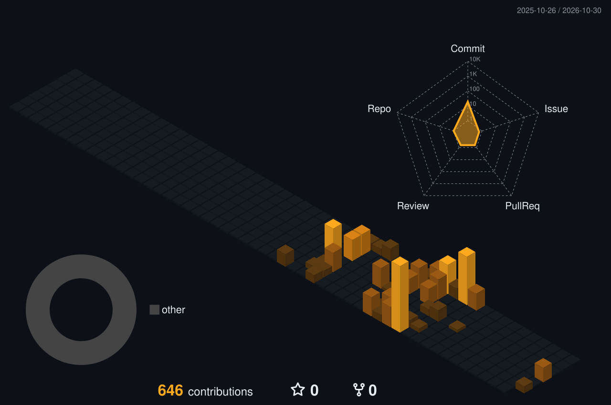

<p align="center">
  
</p>

<p align="center">
  
  
  
</p>

### `whoami`

```lua
local IamZach = {
    role       = "FiveM developer",
    languages  = { "Lua", "SQL" },
    stack      = { "ox_lib", "oxmysql" },
    frameworks = { "ESX", "QBCore", "Qbox", "standalone" },
    building   = "devkit",
    principles = { "free", "readable", "framework-agnostic" },
}

return IamZach
```

### Featured

<a href="https://github.com/1amZach/devkit">
  
</a>

### Toolbox

<p>
  
</p>

### Stats

<p align="center">
  
  
</p>



<picture>
  <source media="(prefers-color-scheme: dark)" srcset="https://raw.githubusercontent.com/1amZach/1amZach/output/github-snake-dark.svg" />
  <source media="(prefers-color-scheme: light)" srcset="https://raw.githubusercontent.com/1amZach/1amZach/output/github-snake.svg" />
  
</picture>

<p align="center"><sub>stats, 3D graph and snake rebuild themselves every few hours via GitHub Actions</sub></p>
